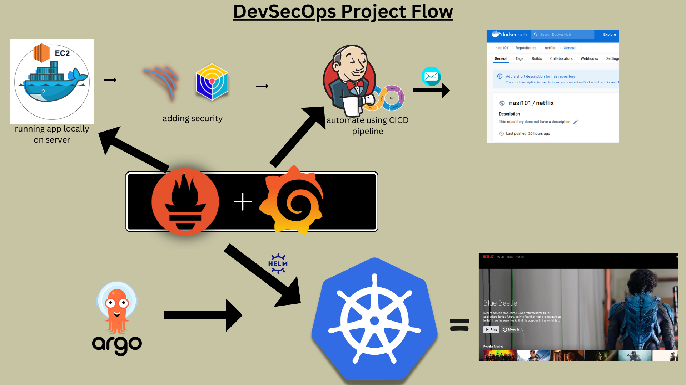

<div align="center">
  

  <br>
  <a href="http://netflix-clone-with-tmdb-using-react-mui.vercel.app/">
    
  </a>
</div>

<br />

<div align="center">
  
  <p align="center">Home Page</p>
</div>

# Deploy Netflix Clone on Cloud using Jenkins - DevSecOps Project!
**Author / Owner:** Narendra Luniwal

### **Phase 1: Initial Setup and Deployment**

**Step 1: Launch EC2 (Ubuntu 22.04):**
- Provision an EC2 instance on AWS with Ubuntu 22.04.
- Connect to the instance using SSH.

**Step 2: Clone the Code:**
- Update all the packages and then clone the code.
- Clone your application's code repository onto the EC2 instance:
    ```bash
    git clone [https://github.com/narendraluniwal/DevSecOps-Project.git](https://github.com/narendraluniwal/DevSecOps-Project.git)
    ```

**Step 3: Install Docker and Run the App Using a Container:**
- Set up Docker on the EC2 instance:
    ```bash
    sudo apt-get update
    sudo apt-get install docker.io -y
    sudo usermod -aG docker $USER
    newgrp docker
    sudo chmod 777 /var/run/docker.sock
    ```
- Build and run your application using Docker containers:
    ```bash
    docker build -t netflix .
    docker run -d --name netflix -p 8081:80 netflix:latest
    
    #to delete
    docker stop <containerid>
    docker rmi -f netflix
    ```
- Note: It will show an error if you haven't provided your TMDB API key.

**Step 4: Get the API Key:**
- Open a web browser and navigate to TMDB (The Movie Database) website.
- Click on "Login" and create an account.
- Once logged in, go to your profile and select "Settings."
- Click on "API" from the left-side panel.
- Create a new API key by clicking "Create" and accepting the terms and conditions.
- Provide the required basic details and click "Submit."
- Recreate the Docker image with your API key:
    ```bash
    docker build --build-arg TMDB_V3_API_KEY=<your-api-key> -t netflix .
    ```

---

### **Phase 2: Security**

1. **Install SonarQube and Trivy:**
   - Install SonarQube and Trivy on the EC2 instance to scan for vulnerabilities.
   - SonarQube installation:
     ```bash
     docker run -d --name sonar -p 9000:9000 sonarqube:lts-community
     ```
     Access via: `publicIP:9000` (default username & password is `admin`).
   - Trivy installation:
     ```bash
     sudo apt-get install wget apt-transport-https gnupg lsb-release
     wget -qO - [https://aquasecurity.github.io/trivy-repo/deb/public.key](https://aquasecurity.github.io/trivy-repo/deb/public.key) | sudo apt-key add -
     echo deb [https://aquasecurity.github.io/trivy-repo/deb](https://aquasecurity.github.io/trivy-repo/deb) $(lsb_release -sc) main | sudo tee -a /etc/apt/sources.list.d/trivy.list
     sudo apt-get update
     sudo apt-get install trivy
     ```
   - Scan container image using Trivy:
     ```bash
     trivy image <imageid>
     ```

2. **Integrate SonarQube and Configure:**
   - Integrate SonarQube with your CI/CD pipeline.
   - Configure SonarQube to analyze code for quality and security issues.

---

### **Phase 3: CI/CD Setup**

1. **Install Jenkins for Automation:**
   - Install Java on the EC2 instance:
     ```bash
     sudo apt update
     sudo apt install fontconfig openjdk-17-jre
     java -version
     ```
   - Install Jenkins:
     ```bash
     sudo wget -O /usr/share/keyrings/jenkins-keyring.asc [https://pkg.jenkins.io/debian-stable/jenkins.io-2023.key](https://pkg.jenkins.io/debian-stable/jenkins.io-2023.key)
     echo deb [signed-by=/usr/share/keyrings/jenkins-keyring.asc] [https://pkg.jenkins.io/debian-stable](https://pkg.jenkins.io/debian-stable) binary/ | sudo tee /etc/apt/sources.list.d/jenkins.list > /dev/null
     sudo apt-get update
     sudo apt-get install jenkins
     sudo systemctl start jenkins
     sudo systemctl enable jenkins
     ```
   - Access Jenkins in a web browser via `publicIp:8080`.

2. **Install Necessary Plugins in Jenkins:**
   Go to **Manage Jenkins → Plugins → Available Plugins** and install:
   - Eclipse Temurin Installer
   - SonarQube Scanner
   - NodeJs Plugin
   - Email Extension Plugin

3. **Configure Tools & Credentials:**
   - Go to **Manage Jenkins → Tools** to install JDK (17) and NodeJs (16).
   - Go to **Manage Jenkins → Credentials** to add your SonarQube token and DockerHub credentials (ID: `docker`).

4. **Jenkins Pipeline Script:**
   ```groovy
   pipeline {
       agent any
       tools {
           jdk 'jdk17'
           nodejs 'node16'
       }
       environment {
           SCANNER_HOME = tool 'sonar-scanner'
       }
       stages {
           stage('clean workspace') {
               steps {
                   cleanWs()
               }
           }
           stage('Checkout from Git') {
               steps {
                   git branch: 'main', url: '[https://github.com/narendraluniwal/DevSecOps-Project.git](https://github.com/narendraluniwal/DevSecOps-Project.git)'
               }
           }
           stage("Sonarqube Analysis") {
               steps {
                   withSonarQubeEnv('sonar-server') {
                       sh '''$SCANNER_HOME/bin/sonar-scanner -Dsonar.projectName=Netflix -Dsonar.projectKey=Netflix'''
                   }
               }
           }
           stage("quality gate") {
               steps {
                   script {
                       waitForQualityGate abortPipeline: false, credentialsId: 'Sonar-token'
                   }
               }
           }
           stage('Install Dependencies') {
               steps {
                   sh "npm install"
               }
           }
           stage('OWASP FS SCAN') {
               steps {
                   dependencyCheck additionalArguments: '--scan ./ --disableYarnAudit --disableNodeAudit', odcInstallation: 'DP-Check'
                   dependencyCheckPublisher pattern: '**/dependency-check-report.xml'
               }
           }
           stage('TRIVY FS SCAN') {
               steps {
                   sh "trivy fs . > trivyfs.txt"
               }
           }
           stage("Docker Build & Push") {
               steps {
                   script {
                      withDockerRegistry(credentialsId: 'docker', toolName: 'docker') {   
                          sh "docker build --build-arg TMDB_V3_API_KEY=<yourapikey> -t netflix ."
                          sh "docker tag netflix narendraluniwal/netflix:latest"
                          sh "docker push narendraluniwal/netflix:latest"
                      }
                   }
               }
           }
           stage("TRIVY") {
               steps {
                   sh "trivy image narendraluniwal/netflix:latest > trivyimage.txt" 
               }
           }
           stage('Deploy to container') {
               steps {
                   sh 'docker run -d --name netflix -p 8081:80 narendraluniwal/netflix:latest'
               }
           }
       }
    }
   }  

### **Phase 4: Monitoring**

1. **Install Prometheus and Node Exporter:**
   - Create system user and download Prometheus:
     ```bash
     sudo useradd --system --no-create-home --shell /bin/false prometheus
     wget [https://github.com/prometheus/prometheus/releases/download/v2.47.1/prometheus-2.47.1.linux-amd64.tar.gz](https://github.com/prometheus/prometheus/releases/download/v2.47.1/prometheus-2.47.1.linux-amd64.tar.gz)
     tar -xvf prometheus-2.47.1.linux-amd64.tar.gz
     cd prometheus-2.47.1.linux-amd64/
     sudo mkdir -p /data /etc/prometheus
     sudo mv prometheus promtool /usr/local/bin/
     sudo mv consoles/ console_libraries/ /etc/prometheus/
     sudo mv prometheus.yml /etc/prometheus/prometheus.yml
     sudo chown -R prometheus:prometheus /etc/prometheus/ /data/
     ```
   - Set up systemd service for Prometheus and run it on port `9090`.
   - Install Node Exporter for machine metrics:
     ```bash
     sudo useradd --system --no-create-home --shell /bin/false node_exporter
     wget [https://github.com/prometheus/node_exporter/releases/download/v1.6.1/node_exporter-1.6.1.linux-amd64.tar.gz](https://github.com/prometheus/node_exporter/releases/download/v1.6.1/node_exporter-1.6.1.linux-amd64.tar.gz)
     tar -xvf node_exporter-1.6.1.linux-amd64.tar.gz
     sudo mv node_exporter-1.6.1.linux-amd64/node_exporter /usr/local/bin/
     ```

2. **Install Grafana:**
   - Install dependencies and add repository:
     ```bash
     sudo apt-get update
     sudo apt-get install -y apt-transport-https software-properties-common
     wget -q -O - [https://packages.grafana.com/gpg.key](https://packages.grafana.com/gpg.key) | sudo apt-key add -
     echo "deb [https://packages.grafana.com/oss/deb](https://packages.grafana.com/oss/deb) stable main" | sudo tee -a /etc/apt/sources.list.d/grafana.list
     sudo apt-get update
     sudo apt-get -y install grafana
     sudo systemctl enable grafana-server
     sudo systemctl start grafana-server
     ```
   - Access Grafana at `http://<your-server-ip>:3000` (Default login: `admin` / `admin`) and add Prometheus as a data source.

---

### **Phase 5: Notification**

1. **Implement Notification Services:**
   - Configure email extension notifications in Jenkins to alert pipeline statuses.

---

### **Phase 6: Kubernetes & ArgoCD**

1. **Create Kubernetes Cluster with Nodegroups:**
   - Provision your AWS EKS cluster with managed nodegroups.

2. **Monitor Kubernetes via Helm:**
   - Install Prometheus Node Exporter using Helm:
     ```bash
     helm repo add prometheus-community [https://prometheus-community.github.io/helm-charts](https://prometheus-community.github.io/helm-charts)
     kubectl create namespace prometheus-node-exporter
     helm install prometheus-node-exporter prometheus-community/prometheus-node-exporter --namespace prometheus-node-exporter
     ```

3. **Deploy Application with ArgoCD:**
   - Install ArgoCD on your Kubernetes cluster.
   - Configure your GitHub repository (`https://github.com/narendraluniwal/DevSecOps-Project.git`) as a source application in ArgoCD.
   - Access your application via `NodeIP:30007` (ensure port 30007 is open in your security group).

---

### **Phase 7: Cleanup**

1. **Cleanup AWS Resources:**
   - Terminate AWS EC2 instances that are no longer needed.
